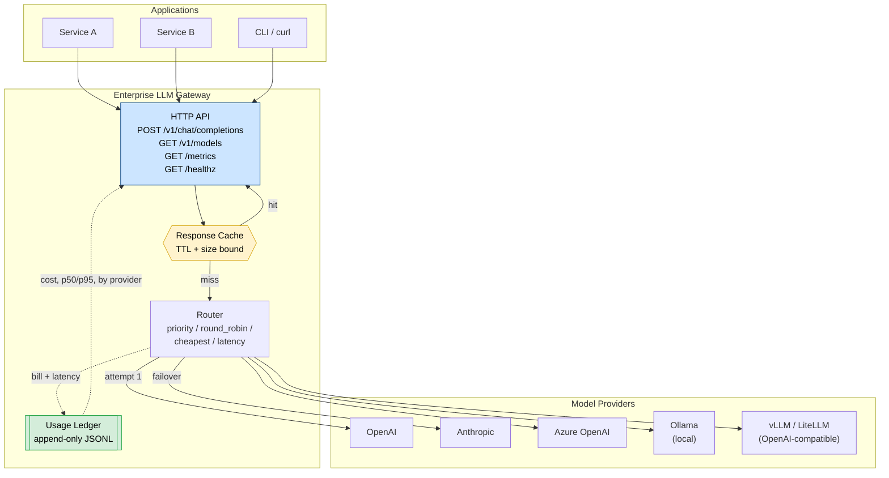

# Enterprise LLM Gateway

**One stable, OpenAI-compatible API in front of every model provider your organisation buys — with caching, failover, and per-request cost attribution built in.**

[](https://www.python.org/)
[](LICENSE)
[](pyproject.toml)
[](https://docs.python.org/3/library/)

---

## The problem this solves

Teams rarely run one model. A typical production estate ends up with OpenAI for
general work, Anthropic for long-context reasoning, Azure OpenAI for enterprise
data-residency commitments, and a self-hosted Ollama or vLLM endpoint for cost
and PII containment. That creates three recurring failures:

| Failure | Consequence |
|---|---|
| Provider-specific SDK calls scattered across services | Every new integration repeats auth, retry, and error handling |
| No failover | One upstream 429 or outage becomes a user-visible incident |
| No cost attribution | The finance conversation becomes "what did we spend, and on what?" |

This gateway collapses those into a single endpoint. Application code depends on
one request shape; operators change providers in a config file, not in code.

---

## Architecture



**Request lifecycle** — one path, three stages:

1. **Cache lookup.** A canonical SHA-256 over the prompt, messages, model, and
   sampling parameters. `metadata` and `user` are excluded so two callers asking
   the same question share one entry. A hit costs nothing and never touches a provider.
2. **Route and execute.** The router orders candidates by the configured
   strategy, then walks that order on failure. Retryable conditions (429, 5xx,
   connection errors) fail over; a malformed request (400/401/403/404) fails
   fast, because retrying it elsewhere only burns latency.
3. **Record.** Provider, model, tokens, cost, and latency land in an append-only
   ledger — successes *and* failures, so reliability and spend share one source of truth.

---

## Features

- **Five routing strategies** — `priority`, `round_robin`, `cheapest`, `latency`.
  `cheapest` ranks providers by estimated cost per call; `latency` ranks by an
  observed EWMA, preferring your configured order until real data arrives.
- **Automatic failover** with a bounded attempt budget and a
  consecutive-failure threshold that demotes sick providers without ever
  taking the whole fleet offline.
- **TTL response cache** with hit-rate accounting and size-bounded eviction.
- **Append-only cost ledger** (JSONL) with per-provider rollups, p50/p95 latency,
  and cache-savings accounting.
- **Prometheus metrics** at `/metrics` — no client library required.
- **Zero runtime dependencies.** Standard library only, so there is no supply
  chain to audit and nothing to install before a security review clears it.

---

## Installation

```bash
git clone https://github.com/sajjad-rabby/enterprise-llm-gateway.git
cd enterprise-llm-gateway
pip install -e .
```

Or run straight from the source tree with no install at all:

```bash
python -m enterprise_llm_gateway.cli --help
```

Python 3.9 or newer. No third-party packages are required at runtime.

---

## Quickstart

```bash
cp config.example.json config.json
export OPENAI_API_KEY=sk-...
export ANTHROPIC_API_KEY=sk-ant-...

# 1. Check the configuration before spending anything
python -m enterprise_llm_gateway.cli validate --config config.json

# 2. See what is routable
python -m enterprise_llm_gateway.cli providers --config config.json

# 3. Send one prompt
python -m enterprise_llm_gateway.cli complete --config config.json \
    "Explain the difference between exponential backoff and jitter"

# 4. Run the server
python -m enterprise_llm_gateway.cli serve --config config.json --port 8080
```

Then point any OpenAI client at it:

```bash
curl http://localhost:8080/v1/chat/completions \
  -H "Content-Type: application/json" \
  -d '{"messages":[{"role":"user","content":"Hello"}]}'
```

---

## Library usage

```python
from enterprise_llm_gateway import Gateway, ModelRequest

gateway = Gateway.from_config_file("config.json")

result = gateway.complete(ModelRequest(
    prompt="Classify this ticket as billing or technical: ...",
    max_tokens=16,
    user="support-bot",
))

print(result.response.content)      # the answer
print(result.provider)              # which provider actually served it
print(result.cached)                # did the cache save a provider call?
print(result.response.usage.to_dict())

# Operational snapshot
stats = gateway.stats()
print(stats["cache"]["hit_rate"], stats["ledger"]["total_cost_usd"])
```

---

## Configuration

Credentials are read from the environment, never from the config file. Any
string value may reference `${VAR}`, which is resolved at load time and raises
a clear error if the variable is unset.

```json
{
  "routing": {
    "strategy": "cheapest",
    "candidates": ["local", "openai-mini", "anthropic"],
    "max_attempts": 3,
    "fail_threshold": 3
  },
  "cache":  { "enabled": true, "ttl_seconds": 3600, "max_entries": 1000 },
  "ledger": { "path": "ledger.jsonl" },
  "providers": {
    "openai-mini": {
      "type": "openai",
      "api_key_env": "OPENAI_API_KEY",
      "default_model": "gpt-4o-mini",
      "timeout_seconds": 60
    },
    "local": {
      "type": "ollama",
      "base_url": "http://localhost:11434",
      "default_model": "llama3.1:8b"
    }
  }
}
```

### Provider types

| `type` | Target | Required fields |
|---|---|---|
| `openai` | OpenAI Chat Completions | `api_key_env` or `api_key` |
| `anthropic` | Anthropic Messages API | `api_key_env` or `api_key` |
| `azure` | Azure OpenAI deployment | `endpoint`, `deployment`, `api_key_env` |
| `ollama` | Local/remote Ollama | `base_url` (optional), `default_model` |
| `openai_compat` | vLLM, LiteLLM, LM Studio | `base_url`, `api_key_env` (optional) |

Optional `prices` maps a model name to `[input_per_1k, output_per_1k]` in USD,
which is what makes the `cheapest` strategy and cost ledger accurate for
self-hosted endpoints where the built-in price tables do not apply.

---

## Choosing a routing strategy

| Strategy | Use when | Behaviour |
|---|---|---|
| `priority` | One provider is authoritative; others are backup | Honours your configured order exactly |
| `round_robin` | You want even load spread across equivalent providers | Rotates the starting candidate per request |
| `cheapest` | Minimising spend matters more than consistency | Ranks by estimated cost of the actual request |
| `latency` | User-perceived speed dominates | Ranks by observed EWMA latency |

Use `cheapest` for background and batch work. Use `priority` for anything where
a specific model's behaviour is baked into your product's expectations.

---

## Operational endpoints

| Endpoint | Purpose |
|---|---|
| `GET /healthz` | Liveness probe with uptime, for Kubernetes or a load balancer |
| `GET /v1/models` | Lists routable providers and their default models |
| `GET /metrics` | Prometheus exposition: cache hit rate, spend, tokens, provider health |
| `POST /v1/chat/completions` | OpenAI-compatible completion endpoint |

Sample `/metrics` output:

```
# TYPE gateway_cache_hit_rate gauge
gateway_cache_hit_rate 0.7143
# TYPE gateway_total_cost_usd gauge
gateway_total_cost_usd 0.184300
# TYPE gateway_provider_latency_ewma_ms gauge
gateway_provider_latency_ewma_ms{provider="openai-mini"} 412.55
```

A `gateway_provider_consecutive_failures`-style drop in traffic alongside a
rising `latency_ewma_ms` on one provider is the signal to investigate upstream
before users notice.

---

## Testing

```bash
pip install pytest
python -m pytest tests -q
```

The test suite runs fully offline: no network calls, no API keys, no Docker.
Provider behaviour is exercised through injected fakes, which is what makes
this repository runnable in CI on day one.

---

## Extending the gateway

Add a provider by implementing `complete()` and `estimate_cost()` on a subclass
of `Provider`, then registering the type in
`enterprise_llm_gateway/providers/__init__.py`:

```python
class MyProvider(Provider):
    def complete(self, request):
        ...
        return ModelResponse(content=..., model=..., provider=self.name, usage=usage)

    def estimate_cost(self, tokens_in, tokens_out, model=None):
        return self._cost_from_prices(tokens_in, tokens_out, price_in, price_out)
```

Because the router, cache, and ledger all operate on the abstract interface, a
new provider automatically inherits failover, caching, and cost accounting.

---

## Security notes

- Secrets are resolved from environment variables; `api_key_env` takes
  precedence over any inline `api_key`, and a missing variable fails loudly
  rather than silently authenticating anonymously.
- The server binds to `127.0.0.1` by default. Put it behind an authenticating
  proxy before exposing it beyond the host — the gateway deliberately does not
  implement tenancy or authentication itself.
- `.gitignore` excludes `config.local.json`, `.env`, and `*.pem` so local
  credentials cannot be committed by accident.

---

## License

MIT — see [LICENSE](LICENSE).

---

**Author:** Sajjad — AI Solutions Architect & AI Ops Specialist
